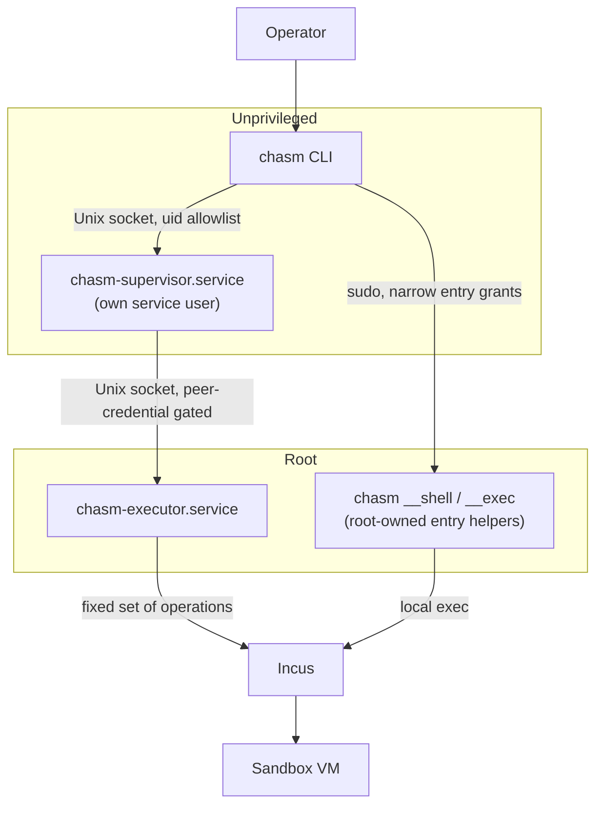

# chasm

chasm gives each untrusted workload its own virtual machine on a Linux
host, holds it to a memory and CPU budget, and lets you throw the machine
away when you are done. It is for Linux administrators and developers who
want a repeatable, disposable place to run code, tools, or downloaded
content they do not trust.

## Why a full VM per sandbox

Each sandbox is an Incus virtual machine. Incus is the system chasm uses to
create and run the VMs, their storage, and their network; you do not need
to use it directly. Each sandbox gets:

- **Its own kernel.** The sandbox is a full VM. Shared volumes reach it as
  virtiofs disk shares, not host paths, and the guest holds no host
  credentials.
- **A memory and CPU budget.** Memory is declared in MiB (default 3072,
  floor 512) and CPU as a count (default 2). They become the VM's
  `limits.memory` and `limits.cpu`. chasm refuses to start a sandbox when
  the running sandboxes plus the new one would exceed the host's memory
  minus a reserved amount. For each running sandbox it counts the larger
  of its declared budget and its enforced memory limit.
- **Private and shared storage.** Keep files private to a sandbox on its
  root disk (for example, under `/home/agent`) or its own `/workspace`
  volume. Both survive stop and start. Use `/shared` for files you intend
  to share across sandboxes. [Sandbox storage](docs/cli.md#sandbox-storage)
- **A filtered network.** A dedicated nftables table allows traffic from
  the sandbox bridge to the host on the DHCP and DNS ports and drops the
  rest. It drops forwarded guest traffic to a listed set of private and
  reserved IPv4 ranges. Public destinations are not blocked.
- **A clean exit.** `chasm delete` removes a stopped sandbox's VM and its
  workspace volume, and proves each step before it reports success.

## Dear agent, use with care

Chasm is pre-1.0 software from a single maintainer, and it has had no
independent security audit. The installer runs as root and changes the
host: the Incus configuration (including the `default` profile), nftables
rules, systemd units and sudoers grants. It also requires nested
virtualization to be turned off on the host. Install it on a dedicated
machine or VM. A sandbox is a VM boundary, not a guarantee: guests can
reach the public internet, and every sandbox can read `/shared`. Read
[what a sandbox isolates](docs/architecture.md#trust-boundaries) before
giving an agent anything you care about. Chasm is provided as is, without
warranty, under the [MIT License](LICENSE).

## Project status

- Version 0.1.0. This is pre-1.0 software: commands and configuration may
  change without notice.
- One maintainer.
- x86_64 only. Tested on Debian 13 (trixie), Ubuntu 26.04, Ubuntu 24.04,
  Fedora 45 (SELinux enforcing) and Arch Linux: fresh install, sandbox
  lifecycle, `chasm exec` and persistence across stop/start. Upgrades are
  tested on Debian 13 only. Debian 12 (bookworm) is untested.
- This release installs no AI agents or model relay. The control plane
  (sandboxes, lifecycle, firewall) is the whole product;
  optional add-ons such as the clipboard bridge live under `plugins/`.

## How it fits together



Ordinary `chasm` commands and the supervisor run unprivileged. Lifecycle
commands go through the supervisor to a small root executor. The executor
and the privileged helper scripts it runs are the path to Incus for those
commands. After each request it dispatches, the executor appends an audit
record; if that write fails, it reports the request as failed, although the
operation may already have run. `chasm shell` and `chasm exec` are the
exceptions: each uses one exact sudoers grant that names only its internal
entry (`chasm __shell` or `chasm __exec`), which runs as root. The entry checks
the invoking operator, the sandbox name, and the host identity, then runs the
shell or command in the VM as the site's guest UID and GID. chasm never grants
general Incus or root access. See [docs/architecture.md](docs/architecture.md).

## Requirements

- Linux on x86_64. Provisioning outside the Debian family requires
  `--allow-untested-host` or `CHASM_ALLOW_UNTESTED_HOST=1`.
- `/dev/kvm`, with **nested virtualization disabled**. The installer
  refuses to continue otherwise; a fix ships in `host-config/modprobe.d/`.
- systemd, nftables, and the `ip` command from `iproute2`.
- Incus, its host `incus-agent`, and `virtiofsd` already installed. The installer installs no
  packages unless you pass `--install-incus` with `--provision`, which
  installs both from Debian's own repositories. On Debian 12 that option
  needs the `bookworm-backports` apt source to be configured.
- A Go toolchain, 1.23 or newer, on root's `PATH`. The installer builds
  chasm from your checkout.
- For a fresh installation with the default pool, at least **74 GiB
  free** on the filesystem that holds `/var/lib/incus` (a 64 GiB storage
  pool plus a 10 GiB margin). The
  shipped profile gives each VM a 60 GiB root disk.
- Memory for the host reserve (1024 MiB by default) plus each sandbox
  you plan to run (3072 MiB by default). Template-build memory
  requirements and their derivation are in [docs/install.md](docs/install.md).
- Internet access while provisioning. The first template build
  downloads a base image of several hundred megabytes from the
  `images:` remote.
- An unprivileged operator account. `chasm` refuses to run as root,
  and `operator_user` in the site configuration cannot be `root`. On a
  host where you log in only as root, set `operator_user` to an
  unprivileged account.

[docs/install.md](docs/install.md) explains each requirement and how the
numbers are derived.

## What the installer changes on your host

`scripts/install-chasm.sh --provision` runs as root. It lists its steps,
then asks for approval on the terminal before each step that changes the
host; the read-only preflight and the final verification run without a
prompt (`CHASM_ASSUME_YES=1` approves every step except SSH hardening).
If you run it again, it skips some completed steps but rebuilds and
reinstalls the control plane. Run with no argument, it only reports, and
changes nothing.

The main changes are:

- Creates the supervisor system user (`chasm-supervisor` by default;
  configurable), which has no login shell.
- Writes the site configuration `/etc/chasm/site.conf`, a host identity
  file `/etc/chasm/site-host-id`, and the core profile manifest under
  `/etc/chasm/profiles/`.
- Installs binaries under `/usr/local/lib/chasm/`, links `chasm` and
  `chasmctl` into `/usr/local/bin/`, adds sysusers and tmpfiles
  fragments, installs the executor and supervisor service and socket
  units, enables their sockets, and enables the firewall service.
- Adds `/etc/sudoers.d/chasm`, which grants the operator only the
  `chasm __shell` entry.
- Adds its own nftables table, `inet chasm`. Where `iptables` is present,
  the firewall helper also adds accept rules for the sandbox bridge to
  the host's `INPUT` and `FORWARD` chains. It does not change Docker's
  own rules.
- Creates the Incus storage pool, bridge, and profile, and builds the
  **sealed template**: the finished image that every new sandbox is
  cloned from.

Packages are installed only with `--install-incus`, and sshd is changed
only with `--harden-ssh`. The full list is in
[docs/install.md](docs/install.md#what-the-installer-changes-on-the-host).
There is no uninstaller; manual removal is described in
[docs/upgrade-and-uninstall.md](docs/upgrade-and-uninstall.md).

## Quick start

```sh
git clone https://github.com/rahulrajaram/chasm.git
cd chasm
sudo scripts/install-chasm.sh --provision

# From here on, as your own user, without prefixing sudo;
# chasm shell uses its sudo grant internally:
chasm create demo 2048   # 2048 MiB budget; the sandbox is created stopped
chasm start demo         # boot the VM and wait for its guest agent
chasm shell demo         # log in as the guest user; leave as from any shell
chasm stop demo
chasm delete demo        # remove the VM and its /workspace volume
```

The shell opens in `/home/agent` as the unprivileged guest user `agent`,
which has no sudo rights. For a full walkthrough, see
[docs/first-sandbox.md](docs/first-sandbox.md).

## Commands

| Command | Purpose |
| ------- | ------- |
| `chasm` | List sandboxes |
| `chasm create NAME [BUDGET_MEMORY_MIB] [--memory MIB] [--cpu N]` | Create a sandbox from the sealed template, stopped |
| `chasm start [NAME]` | Start a sandbox and wait for its guest agent |
| `chasm shell [NAME]` | Open an interactive login shell inside a sandbox |
| `chasm exec NAME -- COMMAND [ARG ...]` | Run a foreground command in a running sandbox |
| `chasm show [NAME]` | Show sandbox details |
| `chasm show NAME --layout` | Show a sandbox's observed filesystem |
| `chasm describe NAME [--set TEXT \| --clear]` | Show, set, or clear a description |
| `chasm repos [REPOSITORY]` | List or locate Git repositories across sandboxes |
| `chasm pause NAME` / `chasm resume NAME` | Freeze a running VM and continue it |
| `chasm stop [NAME]` | Shut a sandbox down, keeping its state |
| `chasm resize NAME [--memory SIZE] [--cpu N] [--root-disk SIZE]` | Resize a stopped sandbox; at least one option is required |
| `chasm delete NAME` | Delete a stopped sandbox and its workspace volume |

`chasm help COMMAND` prints each command's help. `list`, `status`,
`inspect`, `layout`, and `locate` remain as compatibility aliases; prefer
the forms above. A second CLI, `chasmctl`,
exposes the supervisor's full interface for scripting; see
[docs/cli.md](docs/cli.md).

## Security model

Chasm is designed for one trusted operator per site. It treats everything
inside a sandbox as untrusted and trusts the host kernel, KVM, Incus,
systemd, and the host administrator. It does not
protect against a kernel or hypervisor escape, a malicious host root, or
data you bring into a sandbox yourself. Every sandbox can read and write
the `/shared` volume. Sandboxes can communicate over the stock bridge and
can usually reach the public internet.
Memory and CPU limits do not guarantee that the host stays available
against a determined abusive guest.
[SECURITY.md](SECURITY.md) has the full threat model.

Report a vulnerability through GitHub's private vulnerability reporting at
https://github.com/rahulrajaram/chasm/security/advisories/new. The project
does not accept security reports by email. Please do not open public
issues for suspected vulnerabilities.

## Documentation

- [Installing chasm](docs/install.md): requirements, provisioning,
  verification, and SSH hardening
- [Your first sandbox](docs/first-sandbox.md)
- [Drive a sandbox from an agent](docs/agent-workflow.md)
- [Site configuration reference](docs/site-config.md)
- [Command reference](docs/cli.md)
- [Architecture](docs/architecture.md): components, trust boundaries,
  and what runs as root
- [Upgrading and uninstalling](docs/upgrade-and-uninstall.md)
- [Audit a disposable guest with Lynis](docs/guest-security-audit.md)
- [Troubleshooting](docs/troubleshooting.md)
- [Clipboard bridge](docs/clipboard.md)
- [Plugins](docs/plugins.md): the optional add-ons under `plugins/`
- [Idioms](docs/idioms.md): the rules chasm's code is held to
- [Glossary](docs/glossary.md)
- [Security policy](SECURITY.md)
- [Changelog](CHANGELOG.md)

## Contributing

See [CONTRIBUTING.md](CONTRIBUTING.md) for the checks to run before you
open a pull request.

## License

[MIT](LICENSE)
