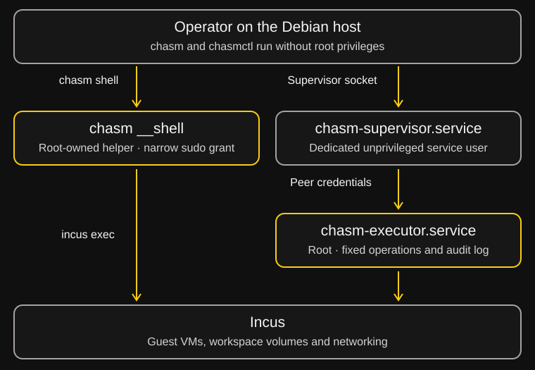
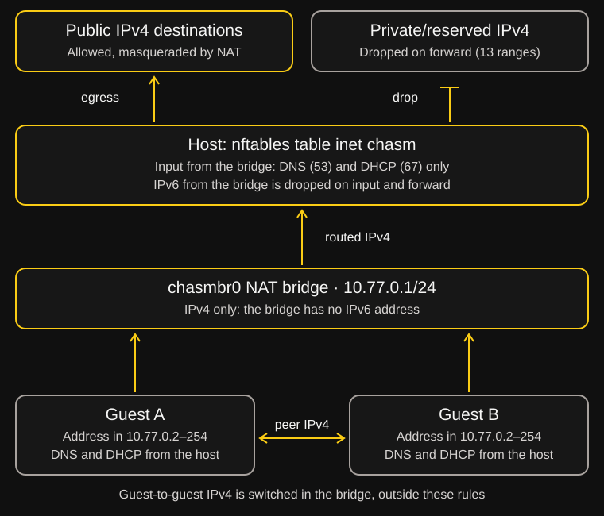

# Architecture

chasm is a host control plane: a small set of daemons, CLIs, and scripts
that manage Incus virtual machines as sandboxes. This page describes the
components, the trust boundaries between them, and the data flow of a
typical command. The security consequences are drawn out in
[SECURITY.md](https://github.com/rahulrajaram/chasm/blob/main/SECURITY.md).

## Components

<figure>
  
  <figcaption>Chasm’s two paths to Incus. <a href="assets/diagrams/control-plane.excalidraw" download>Download the editable Excalidraw diagram</a>.</figcaption>
</figure>

- **`cmd/chasm`** — the operator CLI. Lifecycle and observation commands
  talk to the unprivileged supervisor; `chasm shell` uses the sudo grant
  and a root-owned entry helper to open a shell in the VM as the guest
  user. Lifecycle and observation commands never touch Incus themselves:
  they are delegated to the unprivileged supervisor, and only the
  root executor (its sole client) invokes Incus on their behalf. The one
  exception is the interactive shell: through the sudo grant, the
  root-owned `chasm __shell` entry executes a fixed `/usr/bin/incus exec`
  invocation as the guest user (`cmd/chasm/main.go`, `runPrivilegedShell`);
  only the sudo approval itself is non-interactive (`sudo -n`), while the
  guest shell it launches is interactive (`--mode interactive`,
  `/usr/bin/zsh -l`). chasm never grants general Incus or root access.
- **`cmd/chasmctl`** — the operator-level CLI over the supervisor.
  JSON by default.
- **`cmd/executor_server`** (`chasm-executor.service`, **root**) — the
  privileged control-plane component. Socket-activated on
  `/run/chasm-executor.sock`, which is root-owned, group-restricted to
  the supervisor user, mode 0660. It gates every connection on
  kernel-provided peer credentials, runs a fixed set of privileged
  operations (Incus instance and volume management, launch), and appends
  every dispatched request's disposition to a root-owned JSONL audit log.
- **`cmd/supervisor_server`** (`chasm-supervisor.service`) — runs as its
  own unprivileged system user. It holds the site's writer lease,
  persists performance samples under its state root, serves both CLIs on
  `/run/chasm-supervisor.sock` (root-owned, group-restricted to the
  operator, mode 0660, uid-allowlist gated), and is the only client
  allowed to connect to the executor.
- **`plugins/clipboard`** — the desktop-side clipboard bridge helper, an
  optional, separately built add-on ([plugins.md](plugins.md));
  runs entirely as the desktop user, outside sudo and the sandbox (see
  [clipboard.md](clipboard.md)).
- **`internal/siteconfig` + `scripts/lib/require-site-host.sh`** — two
  independent readers of the site descriptor (`/etc/chasm/site.conf`)
  that must agree; both fail closed on unknown keys, malformed values,
  and contradictions.
- **Site identity pin** — provisioning writes this machine's fingerprint to
  `/etc/chasm/site-host-id` (root 0444). The installer pins it once and
  refuses a mismatch; re-pinning is a deliberate administrator action outside
  normal provisioning.
- **Firewall** — `chasm-firewall` renders and applies
  `host-config/firewall.nft.template` into a dedicated nftables table
  `inet chasm`. Bridge input accepts only DHCP and DNS and drops
  everything else; forwarded guest traffic to private and reserved IPv4
  ranges is dropped. When `iptables` is available, the helper also adds
  accepts for packets arriving from the bridge at the head of the iptables
  `INPUT` and `FORWARD` chains, so those chains' policies do not discard
  traffic the chasm table vetted. Other nftables tables and host firewall
  rules can still affect connectivity. It does not
  rewrite Docker's rules or filter public destinations; these rules do
  not provide general host firewalling.
- **Sealed template** — `scripts/build-sandbox-template.sh` builds a
  disposable builder VM from the bootstrap profile, installs the
  profile's package list, creates the neutral guest account (`agent`,
  uid/gid pinned to the site `guest_uid`, home `/home/agent`, zsh login
  shell — no password, groups, or sudo rights — with a minimal
  `/home/agent/.zshrc` from `guest-config/guest/zshrc` so an interactive
  zsh never runs its first-run newuser menu), verifies no credential files
  (`.netrc`, `.git-credentials`, non-empty `.ssh`) are present, clears shell
  history and SSH host keys, and seals the result as the template every
  `chasm create` clones. The template carries a versioned identity digest
  (currently v6) over its inputs (builder and identity scripts, package
  layer and profile reader, guest zshrc, base image, Incus profile,
  `guest_uid`, `resource_prefix`, and the bootstrap profile manifest), so a
  change to any of them makes the existing template stale.

## Trust boundaries

<figure>
  
  <figcaption>Network boundaries set by the chasm bridge and the <code>inet chasm</code> nftables table. <a href="assets/diagrams/network-boundaries.excalidraw" download>Download the editable Excalidraw diagram</a>.</figcaption>
</figure>

| Boundary | Mechanism |
| -------- | --------- |
| Operator → supervisor | Unix socket, root-owned, operator group, mode 0660; supervisor checks the peer uid against an allowlist |
| Supervisor → executor | Unix socket, root-owned, supervisor group, mode 0660; executor rejects any peer uid other than the supervisor's, before parsing anything |
| Operator → VM shell | sudoers grant naming only the `chasm __shell` entry helper; the helper checks the invoking operator, the single sandbox name, and the site identity pin, then runs the shell as the site's guest uid/gid |
| Host ↔ guest | Full VM boundary: shared volumes are virtiofs disk shares, not host paths. Chasm provisions no host credentials into the guest: shell entry passes a fixed environment, and the template seal rejects `~/.netrc`, `~/.git-credentials`, and a non-empty `~/.ssh`. Anything an operator places in `/workspace` or `/shared` is readable from the guest. |
| Guest → network | The nftables `inet chasm` table admits IPv4 DHCP/DNS to the host, drops routed IPv6 and private/reserved IPv4, and does not filter public IPv4 destinations. Switching between guests on the same bridge is outside these rules. |
| Anything → privileged scripts | Runtime privileged entries (executor, `chasm __shell`, firewall helper, sandbox launcher, template builder) require the pinned site identity and refuse otherwise. Bootstrap and rendering steps run before the pin exists and validate the site descriptor instead. |

**What runs as root:** `chasm-executor.service` and the helpers it launches,
including the sandbox launcher and its private `chasmctl --local-admit-launch`
admission check; `chasm-firewall.service`, which runs as root with its
capability bounding set limited to `CAP_NET_ADMIN` and `CAP_NET_RAW`; and the
narrow sudo entry path into `incus exec` for shells. The supervisor, ordinary
`chasmctl` commands, `chasm`'s non-shell commands, and the clipboard helper
never run privileged.

## Data flow: `chasm start research`

1. `chasm` parses the site descriptor and connects to the supervisor
   socket; the supervisor checks the peer uid.
2. The supervisor forwards the operation to the executor socket. The executor
   checks the peer uid before parsing the request, then checks admission.
3. For an initialized sandbox, the executor starts or resumes the existing VM
   and waits for its guest agent. `chasm create` is the path that clones the
   template, attaches volumes, initializes the guest, and leaves it stopped.
   Start can rerun the launcher to finish an earlier incomplete initialization.
4. The executor attempts to append the outcome after dispatch. If it
   cannot persist the audit record, it reports a generic error. The
   dispatched request may already have changed state.
5. `chasm start` reports success after the guest agent is ready.

## Failure posture

The control plane prefers refusing to guessing: unknown descriptor keys
are fatal on both readers, budget sums that exceed headroom refuse
starts, and a firewall stop that cannot prove its rules gone fails rather
than leaving the bridge open. See [SECURITY.md](https://github.com/rahulrajaram/chasm/blob/main/SECURITY.md) for
the full threat model, and [idioms.md](idioms.md) for the rules on
resources: one truth per resource, drift shown rather than hidden, a
supported path for every change, and limits the host can back.
