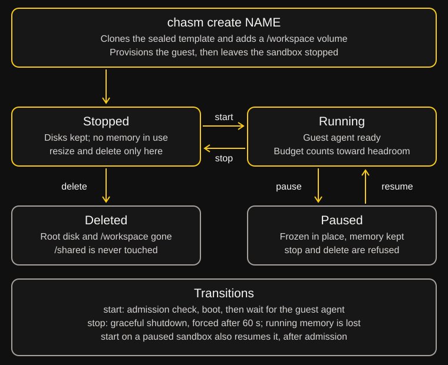

# Your first sandbox

This walkthrough assumes a provisioned site (see
[install.md](install.md)) and runs entirely as the operator user — no
root, no direct Incus access. `chasm` refuses to run as root: run it as
the operator account without `sudo`. The `shell` and `exec` commands
invoke their dedicated grants internally.

<figure>
  <a href="assets/diagrams/sandbox-lifecycle.svg"></a>
  <figcaption>One sandbox’s lifecycle, showing which commands each state accepts. <a href="assets/diagrams/sandbox-lifecycle.excalidraw" download>Download the editable Excalidraw diagram</a>.</figcaption>
</figure>

## 1. Create

```sh
chasm create research
```

The sandbox is created from the sealed template and left **stopped**.
It receives a persistent `/workspace` volume of its own and the global
`/shared` volume used by every sandbox on the site. Give it a memory budget if you want
one other than the 3072 MiB default:

```sh
chasm create research 2048
```

Budgets are declared in MiB with a 512 MiB floor (there is no fixed
product cap; the ceiling is this host's memory minus the site's
`host_reserve_mib`). The budget reserves host
headroom: `chasm start` refuses, naming the resource, when the sum of
running sandbox budgets plus the new budget would exceed that host cap.

A short description helps when several sandboxes exist:

```sh
chasm describe research --set "compiler experiments"
```

## 2. Start

```sh
chasm start research
```

Start boots the VM and waits for its guest agent. Multiple named
sandboxes may run at the same time as long as their budgets fit host
headroom.

## 3. Enter

```sh
chasm shell research
```

This opens an interactive login shell as the unprivileged `agent` user
(the site's guest uid/gid) in `/home/agent`. The command uses a narrow
sudo grant to a root-owned entry helper; chasm never grants general
Incus or root access.

For a one-off command, use foreground exec from the host instead of
opening a terminal session. This command lists the sandbox's `/workspace`
and writes the structured result to a separate file.

```sh
chasm exec research --cwd /workspace --status-fd 3 -- /usr/bin/ls -a 3>exec-status.json
```

Inside the sandbox:

- `/workspace` — this sandbox's persistent volume; explicit projects use
  `/workspace/<projectname>`.
- `/shared` — the global volume shared by all sandboxes on the site.
- SQLite WAL mode fails on these virtiofs mounts. On `/shared` with Incus
  6.0.4, `journal_mode=DELETE` worked, while `journal_mode=WAL` failed
  with `disk I/O error` on the first write. For `/workspace` and
  `/shared`, use rollback journaling or keep the database on the guest
  root disk (for example under `/home/agent`); see
  [troubleshooting.md](troubleshooting.md).
- The guest has the template's tool baseline: zsh and CA certificates from
  the core `minimal` bootstrap profile
  (`guest-config/profiles/minimal.profile`). The optional developer tools
  (git, curl, jq, Python 3 with venv and pip, sqlite3, tmux,
  universal-ctags, vim) are the `developer-tools` plugin profile
  (`plugins/developer-tools`; see [plugins.md](plugins.md)) — to use them,
  install `developer-tools.profile` into `/etc/chasm/profiles` (root-owned,
  0644), set `bootstrap_profile=developer-tools` in `/etc/chasm/site.conf`,
  and rerun `install-chasm.sh --provision` to build that profile's sealed
  template. Only sandboxes created afterwards get it.

### Set a git identity (developer-tools profile only)

The core `minimal` baseline ships no git and no git identity: git is part
of the optional `developer-tools` profile (see section 3 above), so the
steps below apply only if you built your template with that profile
installed (or otherwise installed git yourself).

In every sandbox that does have git, no identity is baked in on purpose:
commits must carry your name and email, and baking one default identity
into every sandbox would misattribute work across every project the
sandbox ever touches. Set one per sandbox (or per repository under
`/workspace`) before committing:

```sh
git config --global user.name "Your Name"
git config --global user.email "you@example.com"
```

Until an identity is set, `git commit` refuses with `Author identity
unknown` — that is git protecting attribution, not a provisioning fault.

Paste with your terminal's normal paste shortcut. Clipboard bridging is
not automatic: a plain `chasm shell NAME` session has no connection to
the desktop clipboard. Application copy actions are bridged to the
desktop clipboard only when you wrap the shell with the optional
`chasm-clipboard` helper (`chasm-clipboard -- chasm shell NAME`; see
[clipboard.md](clipboard.md) and [plugins.md](plugins.md)).

## 4. Observe

```sh
chasm                  # list sandboxes
chasm show research    # status and details
chasm show research --layout   # observed filesystem, three levels deep
chasm repos            # Git repositories seen across sandboxes
```

Observation never starts a stopped sandbox: a running sandbox is read live;
a paused or stopped one returns its last saved observation, or reports that
it has not been observed yet.

## 5. Pause or stop

```sh
chasm pause research   # freeze the VM, preserving its running state
chasm resume research  # continue where it paused; also requests a best-effort guest clock resync
chasm stop research    # ask the guest to shut down; state is kept on disk
```

Paused VMs keep their memory; stopped sandboxes keep their volumes and
restart fresh.

## 6. Delete

```sh
chasm stop research    # deletion is refused while running
chasm delete research
```

Deletion removes the instance, the sandbox's `/workspace` volume, and
its catalog entry, proving each step before reporting success. The
global `/shared` volume is never touched. Deletion is idempotent:
deleting an already-absent sandbox succeeds.

## Compatibility note

`chasm list`, `chasm status NAME`, `chasm inspect NAME`,
`chasm layout NAME`, and `chasm locate NAME` still work and map onto the
commands above; new scripts should use the preferred forms
(`chasm help aliases` lists them).

Continue with [cli.md](cli.md) for the full command surface.
